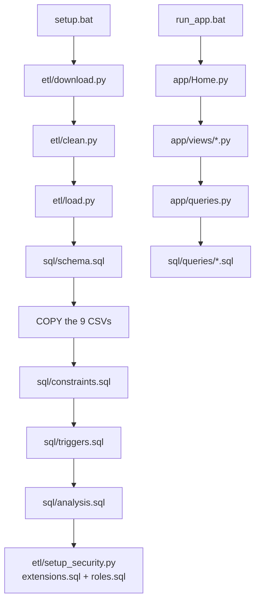

# Code guide: every file and function

This guide explains what each file in the project does and what each function inside it
does. The files are listed **in the order they run**, from downloading the data to showing
a chart. For what the project is and how to run it, see [README.md](README.md).

## The order things run

1. [Project root: setup and configuration](#1-project-root-setup-and-configuration)
2. [ETL: download, clean, load](#2-etl-download-clean-load)
3. [SQL: the database definition](#3-sql-the-database-definition)
4. [SQL: the analysis queries](#4-sql-the-analysis-queries)
5. [App: shared modules](#5-app-shared-modules)
6. [App: the pages](#6-app-the-pages)
7. [Tests](#7-tests)
8. [Scripts](#8-scripts)
9. [Reports](#9-reports)

---

## 1. Project root: setup and configuration

| File | Purpose |
|---|---|
| `setup.bat` | One-time setup on Windows. Checks Python exists, creates `.env` from the template if missing (and stops so you can fill it in), creates `.venv`, installs the packages, then runs download, clean and load in order. Stops at the first step that fails. |
| `run_app.bat` | Starts the dashboard. Activates `.venv`, installs any package that `requirements.txt` gained since setup, then runs `streamlit run app\Home.py`. |
| `requirements.txt` | The Python packages: pandas and numpy (cleaning, tests), psycopg and psycopg-pool (PostgreSQL), python-dotenv (reads `.env`), streamlit and plotly (dashboard), pytest (tests). |
| `.env.example` | Template for `.env`: database host, port and name, the superuser password, the passwords of the two app roles, and the demo account passwords. `.env` itself is never committed. |
| `.gitignore` | Keeps `.env`, the data folders, `.venv` and caches out of git. |
| `pytest.ini` | Tells pytest where the tests are and registers the `slow` marker (tests that load the big CSVs). |
| `.streamlit/config.toml` | Streamlit settings: never show error traces to users, hide the developer menu, and the colour theme. |
| `CLAUDE.md` | The project brief and the notes kept while building the project phase by phase. |
| `README.md` | What the project is, what it found, and how to run it. |

---

## 2. ETL: download, clean, load

### `etl/download.py`: get the raw data

Downloads `ml-25m.zip` from GroupLens and unpacks the six CSV files into `data/raw/`. Safe
to re-run: it skips anything already present.

| Function | What it does |
|---|---|
| `download()` | Downloads the zip to a temporary `.part` file and renames it when complete, so a broken download is never mistaken for a finished one. Skips if the zip exists. |
| `extract()` | Copies the six CSVs out of the zip into `data/raw/`, skipping files already extracted. |
| `count_rows(path)` | Counts the data rows of a CSV (lines minus the header) by reading it in blocks, without loading it into memory. |
| `main()` | Runs download and extract, prints the row count and size of each file, and fails if any of the six is missing. |

### `etl/clean.py`: clean and normalize

Reads the six raw CSVs, checks and fixes them, and writes nine load-ready CSVs to
`data/clean/`, one per database table. Every check and its count goes into
`reports/cleaning_report.md`.

| Function | What it does |
|---|---|
| `section(title)` | Starts a new table in the cleaning report for one input file. |
| `log(check, count, action)` | Records one check (what was checked, how many were found, what was done) in the report and prints it. |
| `to_datetime_str(epoch_seconds)` | Converts Unix timestamps to `YYYY-MM-DD HH:MM:SS` in UTC, a format PostgreSQL's `COPY` accepts. |
| `clean_movies()` | Extracts the release year from the title ("Toy Story (1995)" becomes title "Toy Story", year 1995). Splits the pipe-separated genres into a `genres` table and a `movie_genres` link table. Treats "(no genres listed)" as no genre. Returns the set of valid movie ids. |
| `clean_ratings(movie_ids)` | Processes the 25 million ratings in chunks of 2 million rows. Drops rows with missing values, ratings outside 0.5–5.0, and ratings for unknown movies; removes duplicate (user, movie) pairs keeping the latest. A user's rows are held back at each chunk boundary so duplicates cannot hide across two chunks. Its inner `process(df)` writes one cleaned chunk to the output file. |
| `clean_tags(movie_ids)` | Trims and lowercases tags, drops empty ones and duplicates, and gives each row a surrogate id (`tag_row_id`), because the raw file has no key. |
| `clean_links(movie_ids)` | Keeps the IMDb id as text so leading zeros survive, and leaves a missing TMDb id empty (NULL). |
| `clean_genome(movie_ids)` | Cleans the genome tags, then checks the 15.6 million genome scores in chunks: relevance between 0 and 1, known movie and tag, no duplicates. Counts how many movies have genome data. |
| `main()` | Runs the steps above in order, builds `users.csv` from every user id seen in ratings or tags, and writes the cleaning report. |

### `etl/db.py`: database helper for the ETL scripts

Opens connections as the PostgreSQL superuser, using the settings in `.env`. Only the ETL
and setup scripts use it; the app has its own `app/db.py` with restricted roles.

| Function | What it does |
|---|---|
| `get_connection(dbname, autocommit)` | Returns a psycopg connection as the superuser. |
| `ensure_database()` | Creates the `movielens` database if it does not exist yet. |
| `run_sql_file(path, conn)` | Runs a whole `.sql` file in one transaction: committed on success, rolled back on error. |

### `etl/load.py`: bulk-load PostgreSQL

Loads the nine cleaned CSVs into PostgreSQL and builds everything around them. Every run
drops and recreates the tables, so running it twice gives the same result. Data goes in
first; foreign keys, indexes and triggers come afterwards, because checking 25 million rows
one insert at a time would be far slower. `--report-only` rewrites the load report without
reloading.

| Function | What it does |
|---|---|
| `header(n, title)` / `done(t0)` | Print a step heading and, at the end of the step, how long it took. |
| `preflight()` | Checks that all nine cleaned CSVs exist, creates the database if needed, and warns if less than 8 GB of disk is free. |
| `copy_table(conn, table, columns)` | Streams one CSV into its table with `COPY`, in 1 MB blocks, so even the 25-million-row file is never held in memory. Returns the rows in the CSV, the rows loaded, and the time. |
| `count_csv_rows(table)` | Counts a cleaned CSV's rows without loading it (used by `--report-only`). |
| `load_csvs(conn)` | Loads the nine tables in dependency order and prints rows per second for each. |
| `apply_constraints(conn)` | Runs `sql/constraints.sql` one statement at a time, so each foreign key and index is timed separately. |
| `show_fk_violations(conn, statement)` | If a foreign key fails, prints a query that lists the offending rows and its first 10 results. |
| `table_rows(conn, table)` | Counts the rows of a table that came from the CSVs (for `users`, app accounts are excluded). |
| `check(results, label, left, right)` | Compares two values, prints OK or MISMATCH, and records the result. |
| `reconcile(conn, csv_rows)` | The self-check: compares every table's row count with its CSV, and checks `movie_stats` (counts, averages, one movie's histogram) against the raw ratings. |
| `table_sizes(conn)` / `db_size(conn)` | Read the size of each table (with and without indexes) and of the whole database. |
| `summary(conn, total_seconds)` | Prints the total load time and the sizes. |
| `md_table(headers, rows)` | Formats a list of rows as a Markdown table for the report. |
| `write_report(...)` | Writes `reports/load_report.md`: row counts, checks, keys, indexes, triggers, sizes and timings. |
| `report_only()` | Reconciles and writes the report from the live database; loads nothing. |
| `full_load()` | The whole load, in this order: create tables (`schema.sql`), COPY the CSVs, restart the id counters, fill `movie_stats` (count, sum and histogram per movie), `constraints.sql`, `triggers.sql`, `analysis.sql`, security setup, reconciliation, summary, report. |
| `main()` | Chooses between `full_load()` and `report_only()` from the command line. |

### `etl/setup_security.py`: roles, permissions and demo accounts

Runs as the superuser. Called at the end of every load, and can be run alone after editing
`.env`. Re-runnable.

| Function | What it does |
|---|---|
| `env(key)` | Reads a required setting from `.env` and stops with a clear message if it is missing or still "change-me". |
| `set_role_passwords(conn)` | Sets the passwords of the two database roles from `.env`. They are never printed. |
| `pick_demo_user_ids(conn)` | Chooses which MovieLens users become `demo_user1`–`3`: the lowest user ids with 50–300 ratings, so the demo accounts already have a rating history. Existing demo accounts keep their id. |
| `seed_demo_accounts(conn)` | Creates or updates the `admin` account and the three demo users. Passwords are hashed with bcrypt inside PostgreSQL. |
| `setup(conn)` | Runs `sql/extensions.sql` and `sql/roles.sql`, then the two steps above. |
| `main()` | Opens a superuser connection and calls `setup`. |

### `etl/migrate.py`: update a loaded database without reloading

| Function | What it does |
|---|---|
| `main()` | Applies every file in `sql/migrations/` in name order, then re-applies `triggers.sql`, `analysis.sql` and the security setup. Takes under a minute, against 15–25 minutes for a full reload, and produces the same end state. |

---

## 3. SQL: the database definition

Listed in the order `etl/load.py` runs them.

| File | What it defines |
|---|---|
| `sql/schema.sql` | Drops and creates the 10 tables with their primary keys and CHECK constraints: `movies`, `genres`, `movie_genres`, `users`, `ratings`, `tags`, `links`, `genome_tags`, `genome_scores`, `movie_stats`. Ratings must be 0.5–5.0 in half steps; relevance must be 0–1. `movie_stats` holds each movie's rating count, sum, average and a 10-value histogram, with a CHECK that the histogram adds up to the count. No foreign keys or extra indexes yet. |
| `sql/constraints.sql` | Run after the data is loaded. Adds the 10 foreign keys (a movie's genres, links, genome scores and stats are deleted with it; ratings and tags block the delete) and 7 indexes: ratings by movie, tags by movie and by text, genres by genre, movies by year and by lower-case title, genome scores by movie and relevance. Ends with `ANALYZE`. |
| `sql/triggers.sql` | Function `movie_stats_sync()` and trigger `ratings_movie_stats`: after every insert, update or delete of a rating, adjust that movie's count, sum and histogram slot. Function `movie_stats_truncate()` and its trigger empty `movie_stats` if `ratings` is truncated. Both functions run with their owner's rights (`SECURITY DEFINER`), so a user's rating can update statistics the user may not write directly. |
| `sql/analysis.sql` | Objects for the analysis queries: `tag_stoplist` (junk tags excluded from question c), the materialized view `mv_popular_tags_genre` (distinct users and applications per genre and tag, precomputed because the live query takes about 10 s) with its indexes, and `mv_dataset_summary` (tag count, genome coverage, rating period for the Overview page). |
| `sql/extensions.sql` | Enables `pgcrypto`, used for bcrypt password hashing. |
| `sql/roles.sql` | The security model. Creates the roles `movie_admin` (full control) and `movie_app_user` (read everything except password hashes; insert and update `ratings` only). Enables row-level security on `ratings` with three policies: read all, insert only your own, update only your own. Defines `auth_login(username, password)`, which checks a password inside the database and returns the user's id and role without exposing the hash. |
| `sql/migrations/001_phase4_fixes.sql` | For a database loaded before these fixes: UTC defaults for new timestamps, and auto-numbering for `tags.tag_row_id`. |
| `sql/migrations/002_movies_identity.sql` | Auto-numbers `movies.movie_id`, so the Admin page can add a movie. |
| `sql/migrations/003_rating_histogram.sql` | Adds the rating histogram to `movie_stats`, fills it from `ratings`, and adds the CHECK. This is what made question (d) fast for blockbusters. |

A fresh load already includes everything in the migrations; they exist so an already-loaded
database can be brought up to date in seconds.

---

## 4. SQL: the analysis queries

One file per question in `sql/queries/`. Each takes named parameters and is run by a
function of the same purpose in `app/queries.py`.

| File | Parameters | What it returns |
|---|---|---|
| `a_top_tags_for_movie.sql` | movie | The 5 genome tags with the highest relevance for the movie. No rows means the movie has no genome data. |
| `genome_suggestions.sql` | limit | Well-known movies that do have genome data, suggested when the chosen movie has none. |
| `b_top_movies.sql` | minimum ratings, year (optional) | Top 10 movies by average rating among those with enough ratings, overall or for one release year. Reads `movie_stats`. |
| `c_popular_tags_by_genre.sql` | tags per genre, genre (optional) | The most popular tags per genre, ranked by distinct users, from the materialized view. |
| `genres_list.sql` | none | The 19 genres, for the genre dropdown. |
| `d_rating_distribution.sql` | movie | The count and percentage of the movie's ratings at each of the 10 star values, read from the stored histogram. Always 10 rows. |
| `d_movie_summary.sql` | movie | The movie's title, year, number of ratings and average. |
| `e_ratings_per_movie_distribution.sql` | none | All 62,423 movies grouped into 10 buckets by their number of ratings. |
| `e_ratings_per_movie_summary.sql` | none | Minimum, median, mean and maximum ratings per movie, and the share of all ratings held by the top 10% of movies. |
| `f_top_genre_for_year.sql` | year | Movies per genre for that release year, ranked, with every genre tied for first marked as top. |
| `f_years.sql` | none | Release years that have movies, for the year dropdown. |
| `g_genre_coverage.sql` | none | Per genre: number and share of movies, number and share of ratings, plus a "(no genre)" row. |
| `movie_search.sql` | search text, limit | Title search: prefix matches first, then matches anywhere in the title, most-rated films first. |
| `overview_metrics.sql` | none | The headline numbers on the Overview page. |
| `my_ratings.sql` | user, page | One user's ratings, newest first, one page at a time. |
| `my_rating_for_movie.sql` | user, movie | The user's own rating of one movie, if any. |

---

## 5. App: shared modules

Listed from the lowest layer (database) up to the entry point.

### `app/db.py`: database connections for the app

The app never connects as the superuser. It uses the two restricted roles, each with a
small connection pool created once per process.

| Function | What it does |
|---|---|
| `_pool(role)` | Creates the connection pool for one database role (1 to 4 connections). Cached, so it is built once. |
| `_reset(conn)` | Clears session settings when a connection goes back to the pool. |
| `reset_pools()` | Closes and forgets every pool, so the next query opens fresh connections. Used after a database error, for example when the database was reloaded. |
| `_borrow(role, commit)` | Takes a connection from the pool for one block of work: commits on success, rolls back on error. |
| `user_conn(user_id, commit)` | A connection as `movie_app_user`. If a user id is given, it tells the database who is logged in for this transaction; row-level security compares against it. |
| `admin_conn(commit)` | A connection as `movie_admin`, used only by the Admin page. |

### `app/auth.py`: login, logout and page guards

| Function | What it does |
|---|---|
| `login(username, password, conn)` | Checks a username and password by calling `auth_login` in the database, where the bcrypt comparison happens. Returns the user's id, username and role on success, and nothing on any failure. The app never sees the password hash. |
| `logout()` | Clears the session. |
| `current_user()` | Returns the logged-in user from the session, or nothing. |
| `require_login()` | Called at the top of every page: stops the page if nobody is logged in. |
| `require_role(role)` | Stops the page unless the logged-in user has the given role. The Admin page uses it. |

### `app/navigation.py`: which pages each role sees

| Function | What it does |
|---|---|
| `pages_for(role)` | Returns the list of pages for a role: logged out gets only the login page; a user gets the Overview, (a)–(g) and My ratings; an admin also gets Admin. |

### `app/Home.py`: the entry point

The file Streamlit runs. It sets the page title, builds the menu from the logged-in user's
role, shows the logout button, and runs the chosen page. A database error on any page
becomes a short message instead of an error trace, and the connection pools and cache are
reset.

| Function | What it does |
|---|---|
| `login_page()` | Draws the login page: a Username box, a masked Password box and a Log in button. On submit it calls `auth.login`; a correct password stores the user in the session and reloads, and anything else shows "Invalid username or password." |
| `build_navigation(user)` | Turns `pages_for(role)` into Streamlit's menu structure. |

### `app/queries.py`: the only place the app runs analysis SQL

Each function loads one file from `sql/queries/`, runs it as `movie_app_user` in a
read-only transaction, and returns a pandas DataFrame.

| Function | What it does |
|---|---|
| `load_sql(name)` | Reads `sql/queries/<name>.sql`, once. |
| `run_query(name, params)` | Runs a query file with named parameters and returns a DataFrame. |
| `display_title(title)` | Turns the stored form "Matrix, The" into "The Matrix" for display. Handles English and common non-English articles. |
| `_with_display_titles(df)` | Applies `display_title` to a result's title column. |
| `stored_form(query)` | The reverse: "the matrix" becomes "matrix, the", the way MovieLens stores it. |
| `_like_escape(text)` | Escapes `%` and `_` so they are searched for literally. |
| `search_patterns(query)` | Builds the search patterns for a title search: the text as typed, and its stored form. |
| `search_movies(query, limit)` | Title search for the movie picker. |
| `list_genres()` / `list_years()` | The genre and year lists for the dropdowns. |
| `overview_metrics()` | The Overview page's headline numbers. |
| `top_tags_for_movie(movie_id)` | Question (a). |
| `genome_suggestions(limit)` | Movies to suggest when a movie has no genome data. |
| `top_movies(min_ratings, release_year)` | Question (b). |
| `popular_tags_by_genre(top_n, genre)` | Question (c). |
| `rating_distribution(movie_id)` / `movie_summary(movie_id)` | Question (d): the 10 bars, and the movie's count and average. |
| `ratings_per_movie_distribution()` / `ratings_per_movie_summary()` | Question (e): the histogram, and its summary numbers. |
| `top_genre_for_year(release_year)` | Question (f). |
| `genre_coverage()` | Question (g). |
| `my_ratings(user_id, limit, offset)` | One page of the user's own ratings. |
| `my_rating_for_movie(user_id, movie_id)` | The user's own rating of one movie. |

### `app/data.py`: cached versions of the shared queries

Wraps the queries that give the same answer to everybody in a 10-minute cache. Per-user
queries (My ratings) are deliberately left out.

| Function | What it does |
|---|---|
| `_cached(func)` | Wraps a query function in Streamlit's data cache. |
| `clear()` | Empties the cache. Called after every successful write, so every chart shows the new numbers at once. |

### `app/charts.py`: the one place the chart style is defined

| Function | What it does |
|---|---|
| `_style(fig, title, x_title, y_title, height)` | Applies the shared look: white template, title, axis titles, light grid. |
| `_labels(text, highlight)` | Decides which bars get a value label: all of them for 10 bars or fewer, otherwise only the highlighted ones. |
| `hbar(labels, values, ...)` | Builds a horizontal bar chart, largest at the top, with optional highlighted bars. |
| `vbar(labels, values, ...)` | Builds a vertical bar chart in the given order. |

### `app/components.py`: widgets shared by several pages

| Function | What it does |
|---|---|
| `fmt_int(n)` / `fmt_year(year)` | Format a number with thousands separators, and a year (or "unknown"). |
| `movie_label(row)` | The text of one search result: "The Matrix (1999) · 72,674 ratings". |
| `page_header(question, definition)` | Shows the question as worded in the brief and how it is defined here. |
| `flash(message, kind)` / `show_flash()` | Store a message to show after the page reloads, and show it. |
| `error_box(message, exc)` | Shows a friendly error; the details go to the console only. |
| `metric_row(items)` | A row of metric tiles. |
| `chart_with_table(fig, table, key, ...)` | Shows a chart with a "Show data table" toggle underneath. |
| `movie_picker(key)` | The search box and result list. Remembers the chosen movie across pages. `_pick` and `set_movie` are its callbacks. |
| `selected_movie(movie_id)` | The summary row of the chosen movie. |
| `rating_control(user, movie_id, title, key)` | "Rate this movie": a slider from 0.5 to 5.0 and a Save button. On success it clears the cache, shows the new average and reloads. |

### `app/ratings.py`: the only write a normal user can make

| Function | What it does |
|---|---|
| `validate_rating(rating)` | Checks the value is 0.5–5.0 in half steps, with a clear message. The database enforces the same rule. |
| `upsert_my_rating(user_id, movie_id, rating, commit)` | Adds or changes the logged-in user's rating of a movie, as `movie_app_user` with the user id set, so row-level security rejects a write to anyone else's rating. The trigger updates the movie's statistics. |

### `app/admin_ops.py`: everything the Admin page can change

Every function is one transaction as `movie_admin`, with validated input and parameterised
SQL. A problem the admin can fix raises `AdminError`; `HasActivity` reports that an account
still has ratings or tags.

| Function | What it does |
|---|---|
| `clean_title`, `clean_year`, `clean_username`, `check_password`, `check_role` | Validate one input each: non-empty title, year 1870–2030 or unknown, a valid username, a password of at least 8 characters, a role of admin or user. |
| `movie_detail(movie_id)` | A movie's fields, its genres, and how many rows depend on it. |
| `update_movie(...)` | Changes a movie's title, year and genres. `_set_genres` replaces its genre list. |
| `add_movie(title, release_year, genre_ids)` | Inserts a movie; the database assigns the id. |
| `delete_movie(movie_id)` | Deletes a movie. Refused if it has ratings or tags. |
| `list_accounts()` | The app accounts with their number of ratings and tags. |
| `create_account(username, password, role)` | Creates an account; the password is hashed inside PostgreSQL. |
| `set_role(user_id, role, acting_user_id)` | Changes a role. An admin cannot demote themself. |
| `reset_password(user_id, password)` | Sets a new password hash. |
| `delete_account(user_id, acting_user_id, delete_activity)` | Deletes an account. If it has ratings or tags it reports how many, and deletes them too only after the admin confirms. An admin cannot delete themself. |
| `user_ratings(user_id, limit)` | Any user's ratings, for the Ratings tab. |
| `update_rating(...)` / `delete_rating(...)` | Change or delete any single rating. |

---

## 6. App: the pages

Each file in `app/views/` is one page. Every page first checks the login, then reads its
data through `data.py` (cached) or `queries.py` (per-user), and draws with `charts.py` and
`components.py`.

| File | What the page does |
|---|---|
| `overview.py` | Shows the headline numbers of the dataset as metric tiles, and links to every question page. |
| `a_movie_tags.py` | Movie picker, then a bar chart of the movie's five strongest genome tags on a 0–1 axis. If the movie has no genome data, it says so and offers three well-known movies that do. |
| `b_top_movies.py` | A minimum-ratings slider and two tabs, Overall and By year. Its `show(...)` function draws the top-10 chart and table for one tab, or says that fewer than 10 movies qualify. |
| `c_tags_by_genre.py` | A genre dropdown and a tags-per-genre slider. One genre gives a bar chart; "All genres" gives a grid of 19 small tables. |
| `d_rating_distribution.py` | Movie picker, metric tiles (average, count, your rating), a bar chart of the 10 star values, and the rating control. Saving a rating updates the chart at once. |
| `e_ratings_per_movie.py` | Summary tiles and a bar chart of the 10 buckets, with a log-scale checkbox. |
| `f_genre_by_year.py` | A year dropdown, a headline naming the top genre (all of them if tied), and a bar chart of every genre with the top one highlighted. |
| `g_genre_coverage.py` | A switch between share of movies and share of ratings, and a sorted bar chart including "(no genre)". |
| `my_ratings.py` | Rate a movie, and a paged list of the user's own ratings where a selected row can be changed. Explains that users cannot delete ratings. |
| `admin.py` | Admin only. Three tabs: Movies (edit, add, delete), Users (create, change role, reset password, delete), Ratings (look up any user's ratings; change or delete one). `attempt(...)` runs one operation and turns an `AdminError` into a message; `done(...)` clears the cache and shows the result; `genre_select(...)` is the genre multi-select. |

---

## 7. Tests

147 tests in total. Run with `pytest`. Every test that writes data either runs in a
transaction that is rolled back or restores the original state afterwards.

| File | Tests | What it checks |
|---|---:|---|
| `tests/conftest.py` | 0 | Shared setup: makes the app modules importable, and fixtures such as a superuser connection that never commits, the demo user's id, another user's rating, and a movie with no ratings. |
| `tests/test_titles.py` | 4 functions | `display_title`, `stored_form` and the search patterns, without a database. |
| `tests/test_security.py` | 29 functions | The security model. The user role can read data but not password hashes; it cannot write any table except `ratings`; it can insert and update its own ratings and the statistics follow; updating another user's rating affects 0 rows and inserting one is refused; invalid ratings are rejected by Python and by the database; new ratings get a UTC time; the admin role can do what it should; password login succeeds only with the right password and never returns a hash; the app cannot connect as the superuser by mistake. |
| `tests/test_queries.py` | 18 functions | Every query (a)–(g) and the search, compared with the same answer computed independently in pandas from the cleaned CSVs. The pandas side never uses `movie_stats`, so these tests also prove the trigger-maintained statistics are right. Marked `slow` because they load the big CSVs. |
| `tests/test_app.py` | 23 functions | The Streamlit app, driven by AppTest. The menu per role; the login form has a username box and a masked password box and lists no accounts; the correct password logs in with the account's role; a wrong password, unknown user or empty field is refused with one generic message; the password-free login is gone; a user cannot reach Admin; every page runs without errors for both roles; saving a rating on (d) changes the count and average; the admin safety rules (cannot delete or demote yourself, a user with ratings is not deleted silently, input validation, add and delete a movie, create and delete an account). |

Some test functions run several times with different inputs, which is why 74 functions
make 147 tests.

---

## 8. Scripts

### `scripts/benchmark_queries.py`

Times every analysis query as `movie_app_user` and writes `reports/query_performance.md`.

| Function | What it does |
|---|---|
| `time_query(...)` | Runs one query several times and returns the time of each run in milliseconds; `main()` takes the median and the maximum. |
| `explain(...)` | For a query over the 2-second limit, gets PostgreSQL's execution plan for the report. |
| `main()` | Runs all 22 queries 5 times each, also times question (c) without its materialized view to show why the view exists, and writes the report. Exits with an error if any query is too slow. |

### `scripts/page_timings.py`

Measures how long each dashboard page takes and writes `reports/page_timings.md`.

| Function | What it does |
|---|---|
| `run_page(...)` | Runs one page through the app as a logged-in user and returns the time taken. |
| `main()` | Times all 12 pages twice: cold (cache emptied first, so every query goes to PostgreSQL) and warm (served from the cache). |

---

## 9. Reports

Written by the scripts above; they record what was measured, so the numbers in the README
can be traced.

| File | Written by | Contains |
|---|---|---|
| `reports/cleaning_report.md` | `etl/clean.py` | Every cleaning check with its count and the action taken. |
| `reports/load_report.md` | `etl/load.py` | Row counts against the CSVs, the `movie_stats` checks, keys, indexes, triggers, sizes and load timings. |
| `reports/er_diagram.md` | by hand | The full ER diagram with every column, and the reason for each table. |
| `reports/security.md` | by hand | The permission table, row-level security, the login flow, and who can view what. |
| `reports/query_results.md` | by hand | For each question: the definition, why, the key SQL, sample results and one insight. |
| `reports/query_performance.md` | `scripts/benchmark_queries.py` | The time of every query, with PASS or FAIL against 2 seconds. |
| `reports/page_timings.md` | `scripts/page_timings.py` | Cold and warm load time of every page. |
