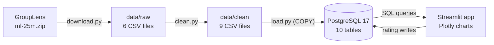
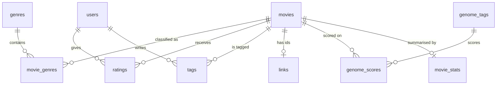

# MovieLens 25M: Data Engineering Dashboard

Course project for **DS5003 Data Engineering Lab, IIT Palakkad**.

This project takes the raw MovieLens 25M CSV files, cleans and normalizes them, loads
41.9 million rows into PostgreSQL, and serves a Streamlit dashboard with role-based
access that answers seven questions about movies, ratings, tags and genres.

## Contents

- [What this project does](#what-this-project-does)
- [Architecture](#architecture)
- [Dataset](#dataset)
- [Data cleaning](#data-cleaning)
- [Database design](#database-design)
- [The seven questions](#the-seven-questions)
- [What the data shows](#what-the-data-shows)
- [Security: roles and access](#security-roles-and-access)
- [Performance](#performance)
- [Verification](#verification)
- [Quick start (Windows)](#quick-start-windows)
- [Setup and running, step by step](#setup-and-running-step-by-step)
- [The dashboard](#the-dashboard)
- [Tests and benchmark](#tests-and-benchmark)
- [Demo accounts](#demo-accounts)
- [Known behaviour](#known-behaviour)
- [Project layout](#project-layout)
- [Dataset licence and citation](#dataset-licence-and-citation)

**Reading the code?** [CODE_GUIDE.md](CODE_GUIDE.md) explains every file and every
function, in the order they run.

## What this project does

The course brief asks for four things, and the project delivers each of them:

| Requirement in the brief | How it is met |
|---|---|
| Process the CSV files and store them in a database, reorganized into suitable tables | `etl/clean.py` and `etl/load.py` turn 6 CSV files into 10 PostgreSQL tables with keys, constraints and indexes |
| Access the database to analyze and visualize the data | 16 parameterised SQL queries in `sql/queries/`, shown as Plotly charts |
| A dashboard that answers questions (a) to (g) | One Streamlit page per question, each with a chart, controls and a data table |
| Two roles, administrators and users; users may modify only ratings | Two PostgreSQL roles, row-level security on `ratings`, and a role-based menu |

The brief also requires user login, data cleaning, visualization and user interaction.
All four are present; see [Security](#security-roles-and-access),
[Data cleaning](#data-cleaning) and [The dashboard](#the-dashboard).

## Architecture



| Stage | Script | What it does |
|---|---|---|
| 1. Download | `etl/download.py` | Fetches `ml-25m.zip`, unpacks the 6 CSVs, prints row counts |
| 2. Clean | `etl/clean.py` | Validates and normalizes the data, writes 9 load-ready CSVs and a cleaning report |
| 3. Load | `etl/load.py` | Bulk-loads with `COPY`, then adds foreign keys, indexes, triggers, roles and demo accounts, and reconciles every table |
| 4. Serve | `app/Home.py` | Login, role-based pages, charts, and live rating changes |

Three design rules run through the whole pipeline:

- **Repeatable.** Every stage can be re-run and gives the same result. A full load ends
  by comparing each table's row count with its CSV, and fails on any mismatch.
- **Least privilege.** The app never connects as the PostgreSQL superuser, only as
  `movie_app_user` or `movie_admin`.
- **Reported.** Each stage writes a report into `reports/`: cleaning, load, security,
  query results, query performance and page timings.

## Dataset

[MovieLens 25M](https://grouplens.org/datasets/movielens/25m/) is a snapshot of the
MovieLens recommendation site published by GroupLens in 2019. It holds ratings and tags
from 162,541 users, given between 9 January 1995 and 21 November 2019.

| File | Rows | One row is |
|---|---:|---|
| `ratings.csv` | 25,000,095 | one user's rating of one movie (0.5 to 5.0 stars) |
| `genome-scores.csv` | 15,584,448 | how relevant one genome tag is to one movie (0 to 1) |
| `tags.csv` | 1,093,360 | one free-text tag a user applied to a movie |
| `movies.csv` | 62,423 | one movie: title and pipe-separated genres |
| `links.csv` | 62,423 | the movie's IMDb and TMDb ids |
| `genome-tags.csv` | 1,128 | one tag of the curated Tag Genome |

**Why ml-25m and not the newer ml-32m:** question (a) asks for tags ranked by relevance
score. Those scores exist only in the Tag Genome files, which ml-25m includes and ml-32m
does not.

The data files are not stored in this repository. `etl/download.py` fetches them from
GroupLens.

## Data cleaning

`etl/clean.py` checks every file and writes the count for each check to
[reports/cleaning_report.md](reports/cleaning_report.md). The two large files are
processed in chunks of 2 million rows, so the script runs on a normal laptop.

| Check | Found | Action |
|---|---:|---|
| Release year inside the title, e.g. "Toy Story (1995)" | 62,011 | Extracted into `release_year`; removed from the title |
| Titles with no year | 412 | `release_year` left NULL |
| Genres stored as one pipe-separated string | 19 distinct genres | Split into `genres` and `movie_genres` (107,245 pairs) |
| Movies marked "(no genres listed)" | 5,062 | No genre rows; shown as "(no genre)" in the dashboard |
| Tags with leading or trailing spaces | 296 | Trimmed |
| Tags with upper-case letters | 274,151 | Lowercased, so "Funny" and "funny" count together |
| Empty tags after trimming | 9 | Dropped |
| Duplicate (user, movie, tag) | 1 | Dropped, keeping the earliest |
| Ratings outside 0.5 to 5.0, duplicates, or for unknown movies | 0 | Checked; nothing to fix |
| Unix timestamps | all | Converted to UTC date-times |
| IMDb ids with a leading zero | 38,396 | Kept as text so the zeros survive |
| Missing TMDb id | 107 | Kept as NULL |
| Genome scores outside 0 to 1, or for unknown movies or tags | 0 | Checked; nothing to fix |

## Database design

Six files become ten tables. The full diagram with every column is in
[reports/er_diagram.md](reports/er_diagram.md).



| Table | Key | Rows | Why it exists |
|---|---|---:|---|
| `movies` | movie_id | 62,423 | Title plus the extracted `release_year` |
| `genres` | genre_id | 19 | Each genre stored once |
| `movie_genres` | (movie_id, genre_id) | 107,245 | Many-to-many link between movies and genres |
| `users` | user_id | 162,541 + app accounts | MovieLens users, plus app accounts with a role |
| `ratings` | (user_id, movie_id) | 25,000,095 | One rating per user per movie; 0.5 to 5.0 in half steps, enforced by a CHECK |
| `tags` | tag_row_id | 1,093,350 | Free-text tags; a surrogate key because the raw file has none |
| `links` | movie_id | 62,423 | IMDb and TMDb ids, one row per movie |
| `genome_tags` | tag_id | 1,128 | The curated genome tags |
| `genome_scores` | (movie_id, tag_id) | 15,584,448 | Relevance of each tag to each movie |
| `movie_stats` | movie_id | 59,047 | Per-movie rating count, sum, average and a 10-value histogram |

**Normalization decisions**

- **First normal form.** The raw `genres` column held several values in one cell
  ("Adventure|Animation|Children"). It is split into a `genres` lookup table and a
  `movie_genres` junction table.
- **One fact per column.** The release year was part of the title text. It now has its
  own column, which questions (b) and (f) filter on.
- **Keys everywhere.** Every table has a primary key, and 10 foreign keys tie the tables
  together. A rating cannot exist for a movie or user that does not exist.
- **A users table.** The raw data only has user ids inside other files. A `users` table
  gives those ids a home and holds the app accounts and their roles. App accounts get ids
  from 200000 upward, so they never collide with MovieLens ids.
- **One deliberate denormalization.** `movie_stats` repeats information that could be
  computed from `ratings`. It exists for speed, and a trigger on `ratings` keeps it
  correct on every insert, update and delete. A CHECK constraint guarantees its histogram
  always adds up to its rating count.

## The seven questions

Each question needed a decision about what exactly it means. The reasoning and sample
results are in [reports/query_results.md](reports/query_results.md).

| | Question in the brief | How it is defined here |
|---|---|---|
| (a) | Top-5 tags of a movie by relevance score | The 5 genome tags with the highest relevance. Only 13,816 of the 62,423 movies have genome data; the others show a message |
| (b) | Overall and year-wise top 10 movies by average rating | Average rating among movies with at least N ratings (default 50, adjustable). Without a minimum, a film rated 5.0 by one person would top the list |
| (c) | Most popular tags for each genre | Number of distinct users who applied the tag to movies of that genre, so one prolific tagger cannot decide the answer. Junk tags such as "in netflix queue" are filtered by a stop list |
| (d) | Distribution of users' ratings for a movie | Count at each of the 10 star values, including zeros. Users can also rate the movie on this page |
| (e) | Distribution of total ratings for movies | Histogram of ratings per movie over all 62,423 movies in 10 buckets, with an optional log scale |
| (f) | Genre that released the most movies in a year | Movies per genre for the chosen release year. All genres are shown, and ties for first place are highlighted |
| (g) | Genre-wise coverage of movies | Count and share of all movies per genre, or share of all ratings, including a "(no genre)" row |

## What the data shows

- **A long tail.** The top 10% of movies (6,243 films) receive 94.5% of all ratings. The
  median movie has 5 ratings; the most-rated, Forrest Gump, has 81,491. 3,376 movies have
  no ratings at all.
- **Best rated.** With at least 50 ratings, TV documentaries lead: Planet Earth II (4.48)
  and Planet Earth (4.47). The Shawshank Redemption (4.41 from 81,482 ratings) is the
  best-rated film with a mass audience.
- **Supply and demand differ by genre.** Adventure is 6.6% of movies but 23.3% of ratings.
  Documentary is 9.0% of movies but 1.3% of ratings.
- **Drama dominates.** Drama is the top genre, or tied for it, in 104 of the 132 release
  years in the data.
- **People think in whole stars.** For Forrest Gump, 4.0 stars gets 28.7% of ratings but
  3.5 stars only 7.6%.
- **Tags describe taste.** Users often re-tag the genre itself ("comedy", "sci-fi"), but
  the other popular tags show what audiences value: "twist ending" in Drama, "dark comedy"
  in Comedy and "dystopia" in Sci-Fi.

## Security: roles and access

The details are in [reports/security.md](reports/security.md).

**Two database roles.** The app connects as one of these, never as the superuser.

| Permission | `movie_app_user` (users) | `movie_admin` (admins) |
|---|---|---|
| Read movies, ratings, tags, genome, statistics | Yes | Yes |
| Add or change a rating | Only their own | Any rating |
| Delete a rating | No | Yes |
| Edit movies, genres, tags | No | Yes |
| Create, change or delete accounts | No | Yes |
| Read password hashes | No | Yes |

**How "users may modify only ratings" is enforced**

- **Grants.** `movie_app_user` has write permission on the `ratings` table only: INSERT,
  and UPDATE of the rating value and its time. It has no DELETE.
- **Row-level security.** A policy on `ratings` allows a write only where `user_id`
  equals the logged-in user. Updating another user's rating affects 0 rows; inserting one
  is refused. PostgreSQL enforces this, so it holds even if the app has a bug.
- **Trigger with owner rights.** Users cannot write `movie_stats`, yet their ratings must
  update it. The trigger function is `SECURITY DEFINER`, so the statistics stay correct
  without widening what users may do.
- **Role-based pages.** The menu is built from the role, and every page also checks the
  login itself. A user's menu has no Admin entry, and opening the Admin page directly
  shows a permission message with no data.

**Login.** Users log in with a username and a password. Passwords are stored only as
bcrypt hashes (pgcrypto, cost 12). The database function `auth_login` checks the password
inside PostgreSQL and returns only the user's id and role, so the hash never reaches the
app. Every failed login gets the same message, so the form does not reveal which usernames
exist. The account's role then decides the menu and the permissions.

## Performance

The slow parts were found by measuring, and fixed by storing results that are expensive
to compute but cheap to keep up to date.

| Problem | Fix | Before | After |
|---|---|---:|---:|
| (d) for a blockbuster reads about 80,000 ratings scattered over the 1.2 GB `ratings` table | A 10-value rating histogram per movie in `movie_stats`, updated by the trigger | 6 to 10 s | a few ms |
| (c) counts distinct users for every genre and tag | A materialized view, rebuilt at load time (tags are read-only in the app) | about 10 s | about 1 ms |
| (b) averages over 25 million ratings | Count and sum per movie in `movie_stats` | full scan | about 35 ms |
| Title search | An index on `lower(title)` for prefix matches | scan | under 70 ms |
| Loading 41.9 million rows | `COPY` into tables with primary keys only; foreign keys, indexes and triggers added afterwards | | 13 to 23 min |

Results: all 22 benchmarked queries run in under 2 seconds
([reports/query_performance.md](reports/query_performance.md)), and all 12 pages load
within their targets ([reports/page_timings.md](reports/page_timings.md)). The loaded
database uses about 3.5 GB.

## Verification

- **147 automated tests**, all passing.
  - *Correctness:* each query (a) to (g) is compared with the same answer computed
    independently in pandas from the cleaned CSVs.
  - *Security:* tests try to break every rule: change another user's rating, read
    password hashes, edit movies as a user. Each attempt is refused.
  - *App:* Streamlit's AppTest runs every page for both roles, including saving a
    rating on page (d).
- **Reconciliation after every load.** Each table's row count is compared with its CSV,
  and `movie_stats` is checked against the raw ratings.
- **Browser check.** Every page was opened in a real browser as a user and as the admin,
  including a live rating change.
- Every test that writes data runs in a transaction that is rolled back, so the tests
  leave the database unchanged.

## Quick start (Windows)

1. Install **Python 3.11+** (tick "Add python.exe to PATH") and **PostgreSQL 17**
   (keep port 5432 and remember the password you give the `postgres` user).
2. Get the code:
   ```powershell
   git clone https://github.com/PranavBK1/DE_lab_project.git
   cd DE_lab_project
   ```
3. Copy `.env.example` to `.env` and replace every `change-me`. `PG_SUPERPASSWORD`
   is your `postgres` password; the others are new passwords of your choice.
4. Double-click **`setup.bat`**. It creates `.venv`, installs the packages,
   downloads MovieLens 25M, cleans it and loads PostgreSQL (about 30–45 minutes
   the first time).
5. Double-click **`run_app.bat`** and open http://localhost:8501. Log in as `admin`
   or `demo_user1` with the passwords you put in `.env` (see [Demo accounts](#demo-accounts)).

You need about 8 GB of free disk space. The same steps by hand are in the next section.

## Setup and running, step by step

### Stack
- PostgreSQL 17: tables, database roles, row-level security, triggers
- Python 3.11+ with pandas and psycopg 3
- Streamlit and Plotly for the dashboard
- pytest for the tests

### Setup
```powershell
python -m venv .venv
.venv\Scripts\activate
pip install -r requirements.txt
copy .env.example .env      # then edit the passwords in .env
```

### Run the pipeline
```powershell
python etl/download.py      # 1. download + unzip ml-25m into data/raw/
python etl/clean.py         # 2. clean, write data/clean/ and reports/cleaning_report.md
python etl/load.py          # 3. create tables, COPY ~41.9M rows, FKs, indexes, triggers,
                            #    roles + demo accounts, reconcile, write reports/load_report.md
python etl/setup_security.py # 4. roles, grants, row-level security, demo accounts
                            #    (load.py already runs this; run it alone after editing .env)
```

`etl/load.py` drops and reloads every table, so it is safe to re-run. A full load
takes **13–23 minutes** on the development laptop and the loaded database uses about
**3.5 GB** (ratings 1.9 GB and genome_scores 1.3 GB, both including indexes).

| step | run 1 | run 2 |
|---|---:|---:|
| COPY of the 9 CSVs (41.9M rows) | 520 s | 460 s |
| populate movie_stats | 26 s | 29 s |
| foreign keys, indexes, ANALYZE | 71 s | 605 s |
| analysis objects (stop list, materialized view) | – | 33 s |
| roles, grants, RLS, demo accounts | 1 s | 2 s |
| reconciliation (counts + movie_stats checks) | 144 s | 225 s |
| **total** | **762 s** | **1,357 s** |

The difference is almost all in the database-wide `ANALYZE` (about 10 s in run 1,
544 s in run 2). Every index and foreign key took the same time in both runs, so the
variation comes from the machine's disk I/O, not from the load. Run 1 predates the
analysis-objects step. A third run on the final code took 1,003 s (16.7 minutes), with
every reconciliation check OK.

See [reports/load_report.md](reports/load_report.md) for every step and table.

Other ETL commands:
```powershell
python etl/load.py --report-only   # rewrite the load report from the live DB, no reload (~15 s)
python etl/migrate.py              # apply sql/migrations/ to an already-loaded DB, no reload
```

Do not run `etl/load.py` while the app is open: it drops and rebuilds the tables the app
is reading.

### Run the app
```powershell
streamlit run app/Home.py   # run from the project root, so .streamlit/config.toml is used
```
Open http://localhost:8501 and log in with a demo account. The menu depends on the role: a
user sees the Overview, the 7 question pages and **My ratings**; an admin also sees
**Admin**. Logged out, only the login page exists.

The app connects as `movie_app_user` (and `movie_admin` on the Admin page) through small
connection pools, never as the superuser. Shared results are cached for 10 minutes,
and every rating change or admin edit clears the cache, so all charts show the new
numbers at once. If PostgreSQL is down or being reloaded, pages show a short message
instead of an error trace.

**If the app shows an error on start:** the virtual environment is probably missing a
package. `run_app.bat` installs anything missing before it starts; by hand, run
`pip install -r requirements.txt` inside `.venv`.

## The dashboard

### Pages
| page | question | controls |
|---|---|---|
| Overview | dataset at a glance | links to every page |
| (a) Tags of a movie | top-5 genome tags for a movie | movie search |
| (b) Top-rated movies | top 10 by average rating, overall and per year | min-ratings slider, *Overall / By year* tabs, year |
| (c) Popular tags by genre | most popular user tags per genre | genre (or all genres), tags per genre |
| (d) Rating distribution | how a movie's ratings spread over 0.5–5.0 stars | movie search, **rate this movie** |
| (e) Ratings per movie | histogram of ratings per movie | log-scale toggle |
| (f) Top genre by year | genre with the most releases in a year (ties shown) | year |
| (g) Genre coverage | count and % of movies (or ratings) per genre | share of movies / share of ratings |
| My ratings | the user's own ratings, newest first, editable | movie search, page, select a row to edit |
| Admin (admin only) | manage movies, accounts and ratings | tabs *Movies / Users / Ratings* |

Every analysis page has a "Show data table" toggle under its chart. Titles are shown in
natural order ("The Matrix"), although MovieLens stores them as "Matrix, The", and the
search accepts either form.

### Browser check list
Use the usernames and passwords under [Demo accounts](#demo-accounts). Steps 6–8 use *Sabrina (1995)*; any movie works, blockbusters included.

1. Open http://localhost:8501 while logged out. Only **Log in** is in the menu, and there is no Admin entry.
2. Log in as `demo_user1`. The sidebar shows "Logged in as **demo_user1** (user)", and the menu has Overview, (a)–(g) and My ratings, **but no Admin**.
3. **Overview:** the tiles show 62,423 movies, about 25.0M ratings, 1,093,350 tags, and 13,816 movies with genome data (22.1%). The links open each page.
4. **(a):** search `the matrix`, pick *The Matrix (1999)*. You get 5 bars (dystopic future, scifi, cyberpunk, …) on a 0–1 axis. Then search `terminator: dark` and pick *Terminator: Dark Fate (2019)*, which has no genome data (it is too recent). You get the info message and 3 suggestion buttons, and clicking one loads its tags.
5. **(b):** the overall top 10 starts with *Planet Earth II*. Move the slider to 1,000 and the list changes. In the *By year* tab, 1995 starts with *The Usual Suspects*. With the slider at 1,000, pick 1915: it should say that fewer than 10 (or no) movies qualify.
6. **(d) rating, the live-demo moment:** search `sabrina`, pick *Sabrina (1995)*. Note the average and the count. Under **Rate this movie**, choose 5.0 and click **Save rating**. A green message shows the new average, the count goes up by 1, "Your rating" shows 5.0 ★, and the 5.0 bar grows by 1.
7. **Cache cleared after the rating:** open **Overview**. The *Ratings* tile is exactly 1 higher than in step 3 (e.g. 25,000,096). On (g), *Share of ratings*, the Comedy and Romance rating counts in the data table also went up by 1. This works because every write clears the shared cache.
8. **My ratings:** *Sabrina* is at the top of the list (newest first). Select its row, change the rating to 2.0 and save; the average updates again. The page explains that users cannot delete ratings.
9. **(c), (e), (f), (g):**
   - (c) *All genres* shows a grid of 19 small tables; choosing *Horror* gives a bar chart.
   - (e) tick *Log scale*.
   - (f) 1995 says Drama (297 movies); 1916 shows a tie between **Comedy and Drama**, both bars in blue.
   - (g) switch between *Share of movies* and *Share of ratings*, and check the note saying the shares add up to more than 100%.
10. Log out, then log in as `admin`. The menu now has **Admin**.
11. **Admin edit:**
    - *Movies* tab: search `sabrina`, add the genre *Drama* (or change the title), then save. A green message appears. Undo the change.
    - *Ratings* tab: user_id `1` lists demo_user1's ratings. Set the Sabrina rating back, or delete it with the confirmation checkbox, to restore the original state.
12. **Blocked user delete:** in *Users*, choose `demo_user2` and open **Delete this account** → **Delete account**. You should see "This user has 184 ratings and 0 tags. Delete them first?" with a confirm checkbox. **Do not confirm.** Then choose your own `admin` account: delete and demote are not offered.
13. **Logout:** click **Log out**. You are back on the login page, and refreshing does not log you in again.

## Tests and benchmark
```powershell
pytest                          # everything (~45 s): security, titles, queries vs pandas, app
pytest -m "not slow"            # skip the pandas comparisons that load the big CSVs (~15 s)
python scripts/benchmark_queries.py   # every query 5x as movie_app_user -> reports/query_performance.md
python scripts/page_timings.py        # cold/warm load of every page -> reports/page_timings.md
```
The tests need the loaded database and the cleaned CSVs in `data/clean/`. Every test
that writes runs in a transaction that is rolled back, so the database is left unchanged.
The analysis queries are in `sql/queries/` and are described, with sample results, in
[reports/query_results.md](reports/query_results.md).

## Demo accounts
Four accounts are seeded by `etl/setup_security.py`. Each logs in with its username and
a password.

| username | role | password is the value of | MovieLens user_id | ratings at load |
|---|---|---|---|---|
| admin | admin | `DEMO_ADMIN_PASSWORD` in `.env` | 200000 (new app account) | 0 |
| demo_user1 | user | `DEMO_USER1_PASSWORD` in `.env` | 1 | 70 |
| demo_user2 | user | `DEMO_USER2_PASSWORD` in `.env` | 2 | 184 |
| demo_user3 | user | `DEMO_USER3_PASSWORD` in `.env` | 4 | 242 |

Each account has its own password, and **you choose them**. The passwords are never shown
on the website and are not in this README or anywhere in git: they live only in `.env`
(never committed), and the database stores only bcrypt hashes.

**To choose or change the passwords:** with PostgreSQL running, double-click
**`set_passwords.bat`** (or run `python etl/set_passwords.py`). It asks for a password for
each of the four accounts, twice, without showing what you type. Short, easy passwords are
allowed. It saves them in `.env` and applies them to the database in a few seconds, without
reloading any data. An older `.env` with one shared `DEMO_USER_PASSWORD` still works for the
three users until you run it. An admin can also create accounts and reset passwords on the
Admin page (there, at least 8 characters).

What the role decides is enforced by PostgreSQL: a user sees the Overview, (a)–(g) and only
their own ratings, and can change only their own ratings; the admin also gets the Admin page.

The demo users are the 3 lowest MovieLens user_ids with 50–300 ratings. Roles,
row-level security and the login flow are described in [reports/security.md](reports/security.md).

### Manual login check
Start `streamlit run app/Home.py` and open http://localhost:8501.

1. **The form:** the login page has a **Username** box and a masked **Password** box. It offers no list of accounts and shows no passwords.
2. **Admin:** log in as `admin` with the admin password you chose. You should see "Logged in as **admin** (admin)" and an **Admin** entry in the menu.
3. **User:** log out, then log in as `demo_user1` with its password. You should see "Logged in as **demo_user1** (user)" and **no** Admin entry.
4. **Wrong password:** log in as `demo_user1` with any other password. You should see "Invalid username or password." and stay on the login page.
5. **Unknown user:** any username that is not one of the four accounts gets the same message, with no hint whether the user exists. The 162,541 MovieLens users have no username or password and cannot log in.
6. **Own data only:** as `demo_user1`, **My ratings** lists only that user's 70 ratings.
7. **Logout:** click **Log out**. The login page should be back, and refreshing the page should not log you in again.

The automated tests log in through this form with the real password of each of the four
accounts, check that the page shows no passwords, and try five kinds of wrong login. In a real browser, the form and a refused wrong password
were checked on 2026-11-16. Every page for both roles, and a live rating change on page
(d), were checked on 2026-11-14.

## Known behaviour
- Sequence and identity values are not transactional, so rolled-back inserts (for example by the tests) leave harmless gaps in ids such as `tags.tag_row_id` and `movies.movie_id`.
- **Page (d) reads a stored histogram.** `movie_stats.rating_hist` holds each movie's 10 rating counts (0.5–5.0 stars), kept current by the ratings trigger and guarded by a CHECK that it always adds up to `rating_count` (migration `003_rating_histogram.sql`). Before this, a blockbuster such as Forrest Gump took 6–10 s on a cold cache, because its ~80k ratings are spread over ~53,000 pages of the 1.2 GB `ratings` table; now it takes a few milliseconds.
- The (c) tag counts and the Overview's tag / genome / rating-period tiles come from materialized views built at load time. An admin's genre edits show up in (c) after the next `python etl/migrate.py` or full load.
- The user role can read every row of `ratings`, because questions (b), (d), (e) and (g) are computed from all users' ratings and MovieLens user ids are anonymous numbers. The app never shows a user another user's individual ratings. See section 8 of [reports/security.md](reports/security.md).

## Project layout
```
etl/           download, clean, load, migrate, setup_security, set_passwords
sql/           schema, constraints, triggers, analysis, extensions, roles,
               migrations/, queries/ (one file per question)
app/           Streamlit app: Home.py (login + navigation), views/ (one page each),
               queries, data (cache), charts, components, admin_ops, auth, db
tests/         security, queries vs pandas, titles, app (AppTest)
scripts/       query benchmark, page timings
reports/       cleaning, load, security, query results, performance and page-timing
               reports; ER diagram
.streamlit/    Streamlit config (theme, no error details for users)
setup.bat      one-time setup: environment, download, clean, load
run_app.bat    start the dashboard
set_passwords.bat  choose the four login passwords (typed hidden, saved in .env)
.env.example   settings template; copy to .env (never committed)
CODE_GUIDE.md  what every file and function does, in running order
CLAUDE.md      project brief and phase-by-phase working notes
data/          raw and cleaned CSVs (created by the pipeline, git-ignored)
```

## Dataset licence and citation

The MovieLens data belongs to GroupLens Research at the University of Minnesota and is
not redistributed here; the pipeline downloads it from GroupLens. Its use is subject to
the terms in the dataset's own README, which ask for this citation:

> F. Maxwell Harper and Joseph A. Konstan. 2015. The MovieLens Datasets: History and
> Context. *ACM Transactions on Interactive Intelligent Systems* 5, 4: 19:1–19:19.
> https://doi.org/10.1145/2827872
