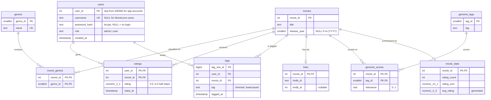

# ER diagram: MovieLens 25M database

Source of truth: `sql/schema.sql` (tables, PKs, CHECKs), `sql/constraints.sql` (FKs, indexes),
`sql/triggers.sql` (movie_stats trigger). All timestamps are stored as `TIMESTAMP` holding UTC.

**Foreign-key delete rules.** `ON DELETE CASCADE` on movie_genres, links, genome_scores and
movie_stats: these rows describe the movie and mean nothing without it. ratings and tags keep the
default (refuse the delete), so deleting a movie or user that still has user-generated data fails
instead of silently erasing it.

## Tables

**movies** — one row per MovieLens movie (62,423). The raw title "Toy Story (1995)" packed two
facts into one field; the year was extracted into `release_year` (NULL for the 412 titles without
one) so year filters are a plain indexed column rather than string parsing (atomic values, 1NF).

**genres** — one row per distinct genre (19). The raw `genres` field was a pipe-separated list,
which violates 1NF; splitting it out gives each genre a single stored name.

**movie_genres** — one row = "movie M belongs to genre G" (107,245 pairs). This is the junction
table that resolves the many-to-many relationship created by the 1NF split. Movies with
"(no genres listed)" simply have no rows.

**users** — one row per user. The raw data has no users file; ids are derived from ratings/tags
(162,541) so that ratings and tags can have a real foreign key. App accounts add a username,
bcrypt hash and role, and take ids from `users_user_id_seq` (starting at 200000) so they never
collide with MovieLens ids.

**ratings** — one row = one user's current star rating of one movie (25,000,095). The natural key
(user_id, movie_id) is the PK, which enforces "one rating per user per movie"; CHECK enforces the
0.5–5.0 half-star domain.

**tags** — one row = one free-text tag a user applied to a movie at a time (1,093,350). The raw file
has no id and (user, movie, tag) was only unique after cleaning, so a surrogate key `tag_row_id`
gives each row a stable, compact identity.

**links** — one row = the IMDb/TMDb ids for one movie (1:1 with movies). Kept separate because they
are external references, not movie attributes used in analysis; imdb_id is text to keep leading
zeros.

**genome_tags** — one row per curated Tag Genome tag (1,128). Its own table so the tag text is
stored once rather than 15.6M times in genome_scores.

**genome_scores** — one row = how relevant genome tag T is to movie M (15,584,448 rows; 13,816
movies × 1,128 tags). Fully normalised fact table keyed by (movie_id, tag_id).

**movie_stats** — one row = rating count, sum and average for one movie. This is a *deliberate
denormalisation*: the values are derivable from ratings, but computing them over 25M rows on every
dashboard request is too slow. It is bulk-populated once after the load and then kept exact by the
`ratings_movie_stats` trigger (insert, update incl. a changed movie_id, delete). `avg_rating` is a
stored generated column, so it can never drift from count and sum.
